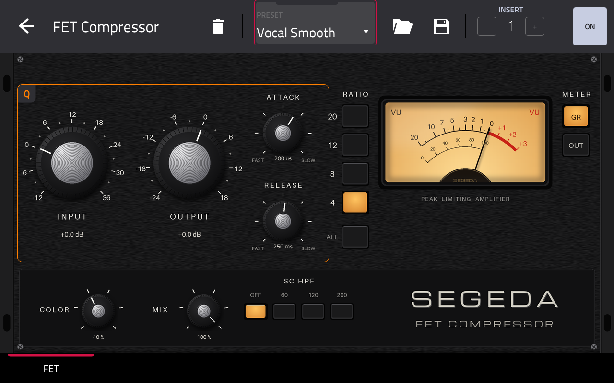

# FET Compressor (Segeda)

A classic FET-style peak compressor for MPC standalone. It's fast, punchy and a bit dirty when
pushed, and it has a backlit **analog VU meter** whose needle swings with the gain reduction,
like the hardware. It comes with a variety of presets for vocals, drums, bass, guitar,
keys, synths and the mix bus, so you can start from a sound that already fits.

## Install

You need **MPC OS 3.10.1 or later** with **Preferences → Enhancements (Beta) → Enable
Enhancements** and **External Plugin Support** switched on. It runs on 32-bit MPCs (Live, Live II,
One, X, Force …) and 64-bit ones (Live III, One+ …).

- **OpenMPC Plugin Manager:** install FET Compressor from the catalog.
- **By hand:** download `FET-Compressor-<version>-mpc-sdk.zip` from
  [Releases](https://github.com/SoundBot/mpc-fet-compressor/releases), unzip it, and copy the
  folder `Segeda - VST - FET Compressor` into a folder named `VST2 Plugins` on your MPC's drive
  (on a Live III, the internal drive). Restart the MPC.

Load it as an insert effect on a track, program or the master. It's under **External Plugins**.

## How to use it

Like the hardware, the threshold is fixed. **Input** sets how hard it compresses and
**Output** brings the level back up (or down). Turn Input up until the needle swings to the
amount of gain reduction you want, then match the level with Output.

The screen is a rack front panel: big **Input** and **Output** knobs, **Attack** and
**Release** stacked beside them, the **Ratio** button column (20 / 12 / 8 / 4, with **ALL** below
for all-buttons mode), the backlit VU meter and the **Meter** buttons (GR / OUT). The extras the
hardware doesn't have, **Color**, **Mix** and **SC HPF**, sit on the strip along the bottom. Every
knob shows its value underneath. Double-tap a knob for the large editor.

| Control | What it does |
|---|---|
| Input | −12 to +36 dB into the compressor. More Input = more compression and more colour |
| Output | −24 to +18 dB after compression (make-up gain) |
| Attack | 20 to 800 µs, as on the hardware. Faster attack catches transients and adds bite |
| Release | 50 to 1100 ms. Fast release pumps and adds energy; slow release glues |
| Color | 0–100 %: FET/class-A colour. Mostly 2nd harmonic, rising with gain reduction |
| Mix | 0–100 % compressed signal. Below 100 % it's parallel ("New York") compression |
| Ratio | 4:1, 8:1, 12:1, 20:1. Higher ratios also have a higher threshold and a harder knee |
| All Buttons | All-buttons-in mode. It overrides Ratio and over-compresses: louder input gives a *quieter* output, with extra grit, and the needle slams left. For room mics and drum smash |
| Meter | **GR**: gain reduction (rests at 0, swings left: −5 = 5 dB of reduction). **Out**: output level on a VU scale (0 VU = −18 dBFS RMS) |
| SC HPF | Off / 60 / 120 / 200 Hz: filters the detector so the kick or bass doesn't pump the whole mix. The audio itself is not filtered |

Q-Links (bank direction: rows, top first): top row = Input, Output, Attack, Release; second
row = Ratio, All Buttons, Meter; third row = Color, Mix, SC HPF. Touching a control brings its
row under the knobs.

### Built-in programs

A **Default** preset (the starting settings) plus 25 presets, grouped by source. Each one is measured, not guessed: on material peaking around
**−6 dBFS** (a typical MPC track) it gives the gain reduction listed, and Output is set so the
level stays about the same when you switch it on. If your track is hotter or quieter, adjust
**Input** until the needle reads about the amount listed.

| Source | Presets (gain reduction) |
|---|---|
| Vocals | Vocal Smooth (5 dB), Vocal Upfront (9), Rap Vocal (10), Backing Vox (6) |
| Kick / snare / hats | Kick Punch (6), Snare Crack (8), Hats Tame (4) |
| Drum bus / loops | Drum Bus Glue (3), Loop Pump (8), Drum Smash (15, parallel), NY Drums (14, parallel), Room Nuke (20), Sample Crunch (12, parallel, lo-fi) |
| Bass | Bass Grip (6), 808 Control (5) |
| Guitar | Electric Guitar (6), Acoustic Guitar (5) |
| Keys | Piano (4), Keys Bite (5) |
| Synths | Synth Lead (6), Pluck Snap (7), Pad Even (4), Brass & Strings (4) |
| Mix | Mix Bus (2), Peak Limit (2) |

Programs set the controls only; they never touch the meter. `dev/tune_presets.cpp` re-measures
them if the DSP changes. New presets go at the end of the list, because projects remember a
preset by its position.

## How the meter works

The needle is a 48-frame film strip (`skins/vu_meter.png`) bound to a display-only parameter
called **GR Meter**, the last parameter, which can't be automated. The audio code computes the
needle position with VU-style ballistics. A small background thread copies it into that
parameter about 30 times a second, only while the needle moves, and tells the MPC that the
value changed so the screen redraws.

**Not yet verified on hardware.** The rest of the plugin uses standard features. If the needle
doesn't move on your MPC, the compressor still works normally. See "Limits".

## Editing the skin

The whole panel (faceplate, knobs, buttons, meter, TUI.json, Q-Links.json) is drawn by
`make_skin.py` with Pillow; positions are constants at its top. Regenerate, then build:

    python3 make_skin.py
    python3 "$MPC_SDK/tools/build.py" .

`build.py` copies `skins/` as it is.

## Building

This repo holds the plugin project only. It builds with the MPC Plugin SDK
(`mpc-plugin-builder-sdk`), which provides the framework headers, the compilers and the tools.
Point `MPC_SDK` at your SDK checkout, for example:

    export MPC_SDK=../mpc-plugin-builder-sdk
    python3 make_skin.py                                   # only after changing the panel
    python3 "$MPC_SDK/tools/build.py" .                     # -> build/Segeda - VST - FET Compressor/
    "$MPC_SDK/.sdk-tools/host_sim" build/native/fet-compressor.dylib test --wav build/test.wav
    python3 "$MPC_SDK/tools/mpc_remote.py" <mpc-ip> update . --drive 1   # install over Wi-Fi

Presets are tuned with `dev/tune_presets.cpp` (see the comment at its top). Releases are made by
`.github/workflows/release.yml`; the steps are in [docs/RELEASING.md](docs/RELEASING.md).

Needs an SDK whose `framework/mpc_plugin.h` reports program changes to the host
(`setProgram()` calls `notifyHostParameterChanged()` and `requestDisplayUpdate()`). Without that,
choosing a preset doesn't update the MPC's screen.

## Limits (honest list)

- The meter relies on the MPC redrawing a parameter that the plugin changes itself. If a
  future MPC OS stops redrawing it, the needle stays still and the sound is unaffected.
- The needle moves in 48 steps and updates at up to 30 frames a second, and the meter image
  uses about 25 MB of memory on the MPC.
- It is a feed-forward design, not a circuit model: it captures the behaviour (fast peak
  detection, ratio-dependent threshold and knee, all-buttons over-compression, FET colour),
  not every quirk. Release is not program-dependent like the hardware's.
- Stereo channels are always linked (one detector for both sides).
- No lookahead and no oversampling. At the fastest attack with lots of colour, low notes get
  some extra distortion, much as on the hardware.

## CPU

Per sample: two biquads (only working when SC HPF is on), a fast log/exp pair, and a few
multiplies. On a desktop, the simulator measured about 0.07 % of one core per 128-frame block,
so expect well under 5 % of a core on the MPC. The meter thread wakes every 33 ms and does
almost nothing.
